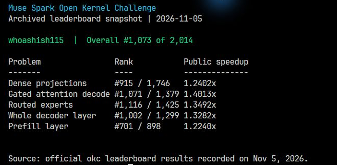

# Muse Spark Open Kernel Challenge

Five optimized GPU kernels for the [official Muse Spark Open Kernel Challenge](https://openkernelchallenge.dev/). The kernel track measured speedup over SGLang on an NVIDIA H200, with correctness checks and CUDA graph timing. [Challenge rules](https://openkernelchallenge.dev/rules)

## Kernels

| Solution | Main optimization |
| --- | --- |
| [Dense projections](muse_bf16_proj/submission.py) | Tunes BF16 matrix multiplication with cuBLASLt and uses specialized kernels for small batches. |
| [Gated attention decode](muse_attention_decode/submission.py) | Splits paged attention across GPU blocks and fuses the final reduction with output gating. |
| [Routed experts](muse_moe_w4a16/submission.py) | Removes nonlocal expert routes before the packed NVFP4 matrix multiplications. |
| [Whole decoder layer](muse_decode_layer/submission.py) | Combines optimized attention and expert kernels, and folds local expert ID conversion into routing. |
| [Prefill layer](muse_prefill_layer/submission.py) | Uses grouped BF16 matrix multiplication for large expert batches and packed NVFP4 kernels for smaller batches. |

Each problem folder contains the solution, SGLang baseline, reference implementation, and correctness checks. The expert and layer problems also include an NVFP4 helper.

## Results



The screenshot records the November 5 leaderboard snapshot. Prefill has its own board. The benchmark record distinguishes the retained code's private checks from the public runs that set the scores above. [Benchmark records](benchmark-results.json) · [Official leaderboard](https://openkernelchallenge.dev/leaderboard)

## Setup and verification

Use Linux or WSL. On Arch Linux, run the package command as root or with `sudo`. Then open this project folder in the Linux shell and run:

```bash
pacman -Syu --needed curl ca-certificates gzip python
bash setup.sh --install-cli
python -m compileall -q muse_*
```

The setup script uses an existing `okc` CLI if available. The compile command checks Python syntax without a GPU. Reproducing the benchmark requires an H200 and the challenge's SGLang/CUDA environment. The kernel submission window is closed. [Challenge updates](https://openkernelchallenge.dev/updates)
